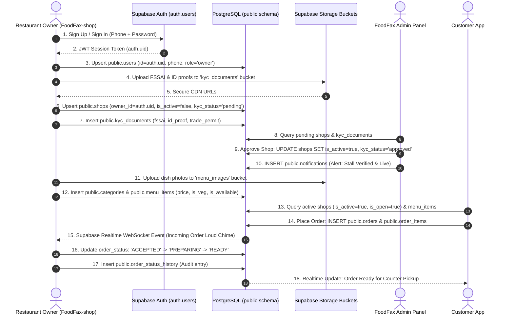

# FoodFax - Database Architecture & Schema Specification

> **Official Single Source of Truth for FoodFax Ecosystem (Shop Owner App, Customer App, Admin Panel)**  
> **Database Engine:** PostgreSQL 17 (Self-Hosted Supabase Docker Stack)  
> **Gateway Endpoint:** `http://127.0.0.1:8000` (Envoy)  
> **Direct Connection (Pooler):** `127.0.0.1:5432`  
> **Last Verified & Updated:** October 2026

---

## 1. Executive Summary & Unified Storage Policy

Sabhi FoodFax applications (**Shop Owner App**, **Customer Ordering App**, **Delivery App**, aur **Admin Panel**) **ek hi single unified PostgreSQL database** se communicate karte hain.

### ⚠️ Strict Rules for All AI Agents & Developers:
1. **Zero Fragmented Storage:** Shop owner, restaurant profile, menu catalog, KYC documents, aur live orders kisi alag/external database, mock server, ya browser localStorage me isolated save **nahi** honge. LocalStorage aur IndexedDB sirf offline resilience aur instant UI cache ke liye hain.
2. **Direct Schema Grounding:** Sabhi apps standard `public`, `auth`, aur `storage` schemas use karte hain.
3. **Admin Panel Compatibility:** Shop Owner app ka data Admin Panel par bina kisi conversion ya mismatch ke direct dikhta hai, kyunki dono exact same database tables aur foreign keys share karte hain.
4. **Instant Synchronization:** Agar database se koi row delete ya update hoti hai, toh frontend Realtime listeners aur state synchronization se turant reflect hota hai.
5. **Anti-Egress Policy:** Har query me lean column projection (`select('id, name, ...')`) aur pagination limits (`limit(50)`) use karna mandatory hai taaki bandwidth aur logs query waste na ho.

---

## 2. Global Data Location Matrix (Kon sa Data Kahan Store Hota Hai?)

| Feature / Domain | Description | Storage Schema & Table / Bucket | Primary Key & Foreign Keys | Accessing Apps |
| :--- | :--- | :--- | :--- | :--- |
| **Authentication & Passwords** | Phone, hashed password, JWT session, auth UID | `auth.users` & `auth.sessions` | `id` (UUID) | Shop Owner, Customer, Admin |
| **Owner & User Profiles** | Full name, phone, role (`'owner'`), linked shop ID | `public.users` | `id` ➔ `auth.users.id` `shop_id` ➔ `shops.id` | Shop Owner, Admin |
| **Restaurant / Stall Profile** | Name, type, GPS, address, UPI ID, active status | `public.shops` | `id` `owner_id` ➔ `users.id` | Shop Owner, Customer, Admin |
| **KYC Legal Verification Docs** | FSSAI, Aadhaar, PAN, Trade permit metadata | `public.kyc_documents` | `id` `shop_id` ➔ `shops.id` | Shop Owner, Admin |
| **Admin Verification Lifecycle** | Admin review requests & multi-doc audit trail | `public.shop_verification_requests` `public.shop_verification_documents` | `shop_id` ➔ `shops.id` `verification_request_id` | Admin, Shop Owner |
| **KYC Physical Files / PDFs** | Uploaded documents, ID proof PDFs, licenses | Storage Bucket: `kyc_documents` (Private) | Storage path: `<shop_id>/<doc_name>` | Shop Owner, Admin |
| **Menu Food Categories** | Category grouping (e.g. Chai, Snacks, Chinese) | `public.categories` | `id` `shop_id` ➔ `shops.id` | Shop Owner, Customer, Admin |
| **Dishes & Menu Catalog** | Food items, prices, veg/non-veg, availability | `public.menu_items` | `id` `shop_id` ➔ `shops.id` `category_id` ➔ `categories.id` | Shop Owner, Customer, Admin |
| **Dish Images & Food Photos** | Uploaded food dish photos | Storage Bucket: `menu_images` (Public) | Storage path: `<shop_id>/<file>` | Customer, Shop Owner |
| **Storefront Banners & Logos** | Stall banner photo & storefront logo | Storage Bucket: `shop_banners` (Public) | Storage path: `<shop_id>/<file>` | Customer, Shop Owner |
| **Profile Avatars** | Owner / Customer profile pictures | Storage Bucket: `avatars` (Public) | Storage path: `<user_id>/<file>` | All Apps |
| **Live Orders** | Real-time incoming & kitchen order fulfillment | `public.orders` | `id` `shop_id` ➔ `shops.id` `customer_id` ➔ `customers.id` | Shop Owner, Customer, Admin |
| **Order Line Items** | Dishes, quantities, item price snapshot | `public.order_items` | `id` `order_id` ➔ `orders.id` `menu_item_id` ➔ `menu_items.id` | Shop Owner, Customer, Admin |
| **Order Transition History** | Timestamped audit log of status changes | `public.order_status_history` | `id` `order_id` ➔ `orders.id` | Shop Owner, Admin |
| **Daily Token Counters** | Running daily token numbers (#001, #002...) | `public.shop_token_counters` | `shop_id` ➔ `shops.id` | Shop Owner, Customer |
| **Payments & Transactions** | UPI / Cash / Online transaction records | `public.payments` | `id` `order_id` ➔ `orders.id` | Shop Owner, Customer, Admin |
| **Push & In-App Notifications**| Live order alerts, kitchen rings, KYC status | `public.notifications` | `id` `shop_id` ➔ `shops.id` | Shop Owner, Customer |
| **Customer App Profiles** | Customer account details, saved addresses | `public.customers` | `id` (Phone / UUID) | Customer App, Admin |
| **Admin Audit Logs** | Super admin approvals, rejections, overrides | `public.admin_audit_logs` | `id` | Admin Panel |

---

## 3. Detailed Database Schemas & Columns

### 1. `auth.users` *(Supabase Internal Auth Schema)*
GoTrue service ka core authentication table. Direct SQL manipulation restricted; accessible via Supabase Auth API and Security Definer functions.

| Column | Type | Description |
| :--- | :--- | :--- |
| `id` | `uuid` (PK) | Unique GoTrue Auth User ID |
| `phone` | `text` (Unique) | Verified mobile number (e.g. `919321444296` or `+919321444296`) |
| `email` | `text` | Internal or user email (e.g. `owner_9321444296@foodfax.internal`) |
| `encrypted_password` | `text` | Bcrypt hashed password |
| `raw_user_meta_data` | `jsonb` | Metadata payload: `{"role": "owner", "full_name": "..."}` |
| `phone_confirmed_at` | `timestamptz` | Phone OTP confirmation timestamp |
| `created_at` | `timestamptz` | Account creation timestamp |

---

### 2. `public.users` *(Owner & Customer Profiles)*
FoodFax ecosystem ka primary user profile table.

| Column Name | Data Type | Constraints | Description |
| :--- | :--- | :--- | :--- |
| `id` | `text` | **PRIMARY KEY** | UUID matching `auth.users.id` (or legacy `owner_<phone>`) |
| `phone` | `text` | **UNIQUE**, NOT NULL | 10-digit mobile number with standard `+91` |
| `email` | `text` | NULLABLE | Email address |
| `full_name` | `text` | NOT NULL | Owner / Customer ka poora naam |
| `role` | `text` | NOT NULL | Role: `'owner'`, `'customer'`, `'admin'`, `'delivery'` |
| `shop_id` | `text` | NULLABLE, FK ➔ `shops.id` | Linked restaurant / food stall ID |
| `password` | `text` | NULLABLE | Auth verification fallback |
| `avatar_url` | `text` | NULLABLE | Profile picture URL from `avatars` bucket |
| `profile_completed` | `boolean` | DEFAULT `true` | Setup completion flag |
| `is_active` | `boolean` | DEFAULT `true` | Account active flag |
| `dashboard_layout` | `jsonb` | NULLABLE | Owner dashboard UI widget preferences |
| `created_at` | `timestamptz` | DEFAULT `now()` | Registration timestamp |
| `updated_at` | `timestamptz` | DEFAULT `now()` | Last profile modification |

---

### 3. `public.shops` *(Restaurant & Food Stall Information)*
Restaurant / Food Cart ki primary entity jo Customer App aur Admin Panel par render hoti hai.

| Column Name | Data Type | Constraints | Description |
| :--- | :--- | :--- | :--- |
| `id` | `text` | **PRIMARY KEY** | Unique Shop ID (e.g. `shop_abc123`) |
| `owner_id` | `text` | NULLABLE, FK ➔ `users.id` | Owner user ID jo is stall ka malik hai |
| `name` | `text` | NOT NULL | Restaurant / Food Cart ka naam |
| `slug` | `text` | NULLABLE | SEO/URL slug (e.g. `foodadda-snacks`) |
| `stall_type` | `text` | DEFAULT `'Food Stall & Food Cart'` | `'Restaurant / Cafe'` ya `'Food Stall / Cart'` |
| `tagline` | `text` | NULLABLE | Short punchline / motto |
| `description` | `text` | NULLABLE | Stall ka brief bio / specialty |
| `image` | `text` | NULLABLE | Storefront logo URL (from `shop_banners` bucket) |
| `banner_image` | `text` | NULLABLE | Header banner photo URL |
| `phone` | `text` | NULLABLE | Primary contact phone |
| `contact_phone` | `text` | NULLABLE | Secondary contact phone |
| `address` | `text` | NULLABLE | Full physical address |
| `area` | `text` | NULLABLE | Neighborhood / Area (e.g. Vasai West) |
| `city` | `text` | DEFAULT `'Vasai-Virar'` | City name |
| `state` | `text` | DEFAULT `'Maharashtra'` | State name |
| `pincode` | `text` | DEFAULT `'401202'` | 6-digit postal code |
| `latitude` | `double precision` | NULLABLE | GPS Latitude for live map & distance radar |
| `longitude` | `double precision` | NULLABLE | GPS Longitude for live map & distance radar |
| `upi_id` | `text` | NULLABLE | Merchant UPI VPA (e.g. `foodadda@okaxis`) |
| `opening_time` | `text` | DEFAULT `'10:00 AM'` | Daily opening time |
| `closing_time` | `text` | DEFAULT `'10:00 PM'` | Daily closing time |
| `is_open` | `boolean` | DEFAULT `true` | Real-time live counter open/close toggle |
| `is_active` | `boolean` | DEFAULT `true` | **Admin Verification Flag** (Active on platform) |
| `is_rush_hour` | `boolean` | DEFAULT `false` | Rush mode toggle (+extra prep time) |
| `table_service_available` | `boolean` | DEFAULT `false` | Accepts dine-in table orders |
| `accepts_delivery` | `boolean` | DEFAULT `false` | Accepts home delivery |
| `delivery_radius_km` | `numeric` | DEFAULT `3.0` | Maximum delivery distance in km |
| `delivery_fee_type` | `text` | DEFAULT `'free'` | `'free'` ya `'fixed'` |
| `delivery_fee_amount` | `numeric` | DEFAULT `0` | Flat delivery fee in ₹ |
| `preparation_time_minutes`| `text` | DEFAULT `'5-10'` | Average preparation time string |
| `kyc_status` | `text` | DEFAULT `'pending'` | `'pending'`, `'approved'`, `'rejected'` |
| `rejection_reason` | `text` | NULLABLE | Admin rejection note if KYC fails |
| `kyc_documents` | `jsonb` | DEFAULT `'{}'` | Full KYC document metadata payload |
| `fssai_number` | `text` | NULLABLE | 14-digit FSSAI food safety license number |
| `fssai_doc_url` | `text` | NULLABLE | Storage CDN URL for FSSAI certificate |
| `owner_id_type` | `text` | NULLABLE | `'aadhaar'` ya `'pan'` |
| `owner_id_number` | `text` | NULLABLE | Government ID number |
| `owner_id_doc_url` | `text` | NULLABLE | Storage CDN URL for Aadhaar/PAN |
| `address_proof_type` | `text` | NULLABLE | Proof type (e.g. Electricity Bill, Rent Agreement) |
| `address_proof_doc_url` | `text` | NULLABLE | Storage CDN URL for Address proof |
| `trade_permit_type` | `text` | NULLABLE | Municipal vendor trade permit type |
| `trade_permit_number` | `text` | NULLABLE | Municipal registration number |
| `trade_permit_doc_url` | `text` | NULLABLE | Storage CDN URL for Municipal permit |
| `is_mobile_stall` | `boolean` | DEFAULT `false` | True if moving food cart / food truck |
| `location_accuracy_meters`| `integer` | NULLABLE | GPS fix accuracy in meters |
| `last_location_updated_at`| `timestamptz` | NULLABLE | Live GPS ping timestamp for mobile carts |
| `created_at` | `timestamptz` | DEFAULT `now()` | Registration date |
| `updated_at` | `timestamptz` | DEFAULT `now()` | Last profile update timestamp |

---

### 4. `public.kyc_documents` *(Merchant KYC Compliance Records)*
Har stall ke individual uploaded verification documents ka legal record.

| Column Name | Data Type | Constraints | Description |
| :--- | :--- | :--- | :--- |
| `id` | `text` | **PRIMARY KEY** | Document ID (e.g. `kyc_<shopId>_fssai`) |
| `shop_id` | `text` | **NOT NULL**, FK ➔ `shops.id` | Linked shop reference |
| `document_type` | `text` | NOT NULL | `'fssai'`, `'owner_id'`, `'address_proof'`, `'trade_permit'` |
| `document_name` | `text` | NULLABLE | Human-readable document title |
| `document_number` | `text` | NULLABLE | License or ID number |
| `document_url` | `text` | NOT NULL | Storage CDN URL (from `kyc_documents` bucket) |
| `status` | `text` | DEFAULT `'pending'` | `'pending'`, `'verified'`, `'rejected'` |
| `rejection_reason`| `text` | NULLABLE | Reason if document was rejected by admin |
| `created_at` | `timestamptz` | DEFAULT `now()` | Upload timestamp |
| `updated_at` | `timestamptz` | DEFAULT `now()` | Review timestamp |

---

### 5. `public.categories` *(Food Menu Categories)*
Menu classification (e.g. Snacks, Beverages, Sandwiches, Chaat).

| Column Name | Data Type | Constraints | Description |
| :--- | :--- | :--- | :--- |
| `id` | `text` | **PRIMARY KEY** | Category ID (e.g. `cat_01`) |
| `shop_id` | `text` | NULLABLE, FK ➔ `shops.id` | Associated shop (Null for platform global presets) |
| `name` | `text` | NOT NULL | Category title |
| `icon_name` | `text` | DEFAULT `'Utensils'` | Lucide icon identifier |
| `description` | `text` | NULLABLE | Category description |
| `display_order` | `integer` | DEFAULT `0` | Sort sequence in UI |
| `is_active` | `boolean` | DEFAULT `true` | Visibility toggle |
| `created_at` | `timestamptz` | DEFAULT `now()` | Creation timestamp |

---

### 6. `public.menu_items` *(Dishes & Catalog)*
Restaurant catalog jo Customer App ordering menu aur Owner App menu manager me dikhta hai.

| Column Name | Data Type | Constraints | Description |
| :--- | :--- | :--- | :--- |
| `id` | `text` | **PRIMARY KEY** | Item ID (e.g. `item_abc123`) |
| `shop_id` | `text` | **NOT NULL**, FK ➔ `shops.id` | Shop ownership |
| `category_id` | `text` | NULLABLE, FK ➔ `categories.id`| Linked category |
| `name` | `text` | NOT NULL | Dish name (e.g. Cheese Pav Bhaji) |
| `description` | `text` | NULLABLE | Dish description & ingredients |
| `price` | `numeric` | NOT NULL | Item selling price in ₹ |
| `image` | `text` | NULLABLE | Dish photo URL (from `menu_images` bucket) |
| `is_veg` | `boolean` | DEFAULT `true` | Vegetarian indicator |
| `is_available` | `boolean` | DEFAULT `true` | In-stock / Out-of-stock toggle |
| `is_bestseller` | `boolean` | DEFAULT `false` | Bestseller badge flag |
| `preparation_time_min`| `integer` | DEFAULT `5` | Kitchen preparation time in minutes |
| `preparation_minutes`| `text` | DEFAULT `'5-10'` | Prep time display string |
| `display_order` | `integer` | DEFAULT `0` | Sorting order inside category |
| `customization_options`| `jsonb`| DEFAULT `'[]'` | Variations/add-ons (e.g. Extra Cheese) |
| `is_active` | `boolean` | DEFAULT `true` | Soft-deletion flag |
| `created_at` | `timestamptz` | DEFAULT `now()` | Creation timestamp |
| `updated_at` | `timestamptz` | DEFAULT `now()` | Last edited timestamp |

---

### 7. `public.orders` *(Live Order Tracking & Fulfillment)*
Customer order placement se lekar kitchen preparation aur delivery tak ka core table.

| Column Name | Data Type | Constraints | Description |
| :--- | :--- | :--- | :--- |
| `id` | `text` | **PRIMARY KEY** | Unique Order ID (e.g. `ord_179260_9820`) |
| `shop_id` | `text` | **NOT NULL**, FK ➔ `shops.id` | Target shop kitchen |
| `shop_name` | `text` | NOT NULL | Shop name snapshot |
| `customer_id` | `text` | NULLABLE, FK ➔ `customers.id`| Placed by customer |
| `customer_name` | `text` | NOT NULL | Customer name |
| `customer_phone` | `text` | NOT NULL | Customer phone number |
| `token_number` | `text` | NOT NULL | Daily token number (e.g. `#001`, `#012`) |
| `order_type` | `text` | CHECK in `'TAKEAWAY'`, `'DINE_IN'`, `'DELIVERY'` | Fulfillment mode |
| `table_number` | `text` | NULLABLE | Dine-in table tag (e.g. `'Table 3'`) |
| `order_status` | `text` | CHECK in `'PENDING'`, `'ACCEPTED'`, `'PREPARING'`, `'READY'`, `'COMPLETED'`, `'CANCELLED'` | Live lifecycle state |
| `payment_status`| `text` | CHECK in `'PENDING'`, `'INITIATED'`, `'PROCESSING'`, `'PAID'`, `'FAILED'`, `'CANCELLED'`, `'EXPIRED'`, `'REFUNDED'`, `'COLLECT_ON_DELIVERY'` | Payment state |
| `payment_method`| `text` | CHECK in `'CASH_AT_COUNTER'`, `'PAY_ONLINE'`, `'UPI'` | Payment mode |
| `subtotal` | `numeric` | NOT NULL, DEFAULT `0` | Items subtotal in ₹ |
| `total` | `numeric` | NOT NULL, DEFAULT `0` | Net payable amount in ₹ |
| `items` | `jsonb` | DEFAULT `'[]'` | Embedded JSON items cache |
| `estimated_preparation_minutes` | `text` | DEFAULT `'5-10'` | Kitchen prep ETA |
| `instructions` | `text` | NULLABLE | Customer cooking instructions |
| `cancellation_reason` | `text` | NULLABLE | Reason if order was rejected by kitchen |
| `cancelled_at` | `timestamptz` | NULLABLE | Cancellation timestamp |
| `cancelled_by` | `text` | NULLABLE | Cancelled by `'owner'`, `'customer'`, `'admin'` |
| `ready_at` | `timestamptz` | NULLABLE | Kitchen mark-ready timestamp |
| `completed_at` | `timestamptz` | NULLABLE | Final fulfillment timestamp |
| `rating` | `integer` | NULLABLE (1-5) | Customer review star rating |
| `review_text` | `text` | NULLABLE | Customer written review |
| `created_at` | `timestamptz` | DEFAULT `now()` | Order placed timestamp |
| `updated_at` | `timestamptz` | DEFAULT `now()` | Last status update timestamp |

---

### 8. `public.order_items` *(Normalized Order Line Items)*
Order ke individual line items for kitchen fulfillment and financial reporting.

| Column Name | Data Type | Constraints | Description |
| :--- | :--- | :--- | :--- |
| `id` | `text` | **PRIMARY KEY** | Line item ID |
| `order_id` | `text` | **NOT NULL**, FK ➔ `orders.id` | Parent order reference |
| `menu_item_id` | `text` | NULLABLE, FK ➔ `menu_items.id`| Source menu item reference |
| `name` | `text` | NOT NULL | Item name snapshot at time of order |
| `price` | `numeric` | NOT NULL | Price snapshot per unit in ₹ |
| `quantity` | `integer` | NOT NULL, DEFAULT `1` | Units ordered |
| `is_veg` | `boolean` | DEFAULT `true` | Veg badge indicator |
| `created_at` | `timestamptz` | DEFAULT `now()` | Created timestamp |

---

### 9. `public.order_status_history` *(Immutable Audit Timeline)*
Dispute resolution aur preparation timeline audit ke liye har status change ka immutable log.

| Column Name | Data Type | Constraints | Description |
| :--- | :--- | :--- | :--- |
| `id` | `text` | **PRIMARY KEY** | Log ID |
| `order_id` | `text` | **NOT NULL**, FK ➔ `orders.id` | Target order |
| `status` | `text` | NOT NULL | Status applied (`PENDING` ➔ `ACCEPTED` ➔ `READY` ➔ `COMPLETED`) |
| `notes` | `text` | NULLABLE | Operator or kitchen notes |
| `created_at` | `timestamptz` | DEFAULT `now()` | Transition timestamp |

---

### 10. `public.shop_token_counters` *(Daily Token Management)*
Takeaway aur Dine-in counters ke liye token number sequence generator.

| Column Name | Data Type | Constraints | Description |
| :--- | :--- | :--- | :--- |
| `shop_id` | `text` | **PRIMARY KEY**, FK ➔ `shops.id` | Associated shop |
| `current_token`| `integer` | DEFAULT `0` | Running counter (e.g. 1, 2, 3...) |
| `date` | `date` | DEFAULT `CURRENT_DATE` | Partition date (resets each morning) |

---

### 11. `public.notifications` *(In-App & Push Notification Queue)*
Merchant and Customer real-time alert dispatch log.

| Column Name | Data Type | Constraints | Description |
| :--- | :--- | :--- | :--- |
| `id` | `text` | **PRIMARY KEY** | Notification ID |
| `shop_id` | `text` | NULLABLE, FK ➔ `shops.id` | Source shop |
| `user_id` | `text` | NULLABLE | Target recipient user/phone |
| `order_id` | `text` | NULLABLE, FK ➔ `orders.id` | Associated order |
| `title` | `text` | NOT NULL | Notification title |
| `message` | `text` | NOT NULL | Message body |
| `type` | `text` | NOT NULL | `'order_new'`, `'order_status'`, `'kyc_approved'`, `'kyc_rejected'` |
| `is_read` | `boolean` | DEFAULT `false` | Read flag |
| `created_at` | `timestamptz` | DEFAULT `now()` | Timestamp sent |

---

### 12. `public.customers` *(Customer Profiles)*
Customer App accounts and saved delivery details.

| Column Name | Data Type | Constraints | Description |
| :--- | :--- | :--- | :--- |
| `id` | `text` | **PRIMARY KEY** | Customer ID (Phone or Auth UUID) |
| `phone` | `text` | NOT NULL | Verified mobile number |
| `full_name` | `text` | NOT NULL | Customer name |
| `email` | `text` | NULLABLE | Email address |
| `address` | `text` | NULLABLE | Primary delivery address |
| `area` | `text` | NULLABLE | Area / Locality |
| `city` | `text` | DEFAULT `'Vasai-Virar'` | City name |
| `pincode` | `text` | NULLABLE | Postal pincode |
| `latitude` | `double precision` | NULLABLE | Delivery GPS latitude |
| `longitude` | `double precision` | NULLABLE | Delivery GPS longitude |
| `is_active` | `boolean` | DEFAULT `true` | Account active flag |
| `created_at` | `timestamptz` | DEFAULT `now()` | Registration timestamp |

---

### 13. `public.payments` *(Transaction Records)*
Customer payments and settlement history.

| Column Name | Data Type | Constraints | Description |
| :--- | :--- | :--- | :--- |
| `id` | `text` | **PRIMARY KEY** | Payment record ID |
| `order_id` | `text` | **NOT NULL**, FK ➔ `orders.id` | Parent order reference |
| `amount` | `numeric` | NOT NULL | Transaction amount in ₹ |
| `payment_method` | `text` | NOT NULL | `'upi'`, `'cash'`, `'card'` |
| `payment_status` | `text` | NOT NULL | `'PAID'`, `'PENDING'`, `'FAILED'` |
| `transaction_id` | `text` | NULLABLE | Bank / UPI Gateway UTR number |
| `created_at` | `timestamptz` | DEFAULT `now()` | Transaction timestamp |

---

## 4. Storage Buckets Specification (`storage.buckets`)

Physical binary files (images, PDFs, documents) **database tables me direct base64 ke roop me store nahi hote** taaki egress aur database storage balloon na ho. Inhe Supabase Storage S3-compatible buckets me rakha jata hai:

| Bucket ID | Public Access | Purpose | Storage Path Structure | Allowed Access |
| :--- | :--- | :--- | :--- | :--- |
| **`kyc_documents`** | ❌ **Private** | FSSAI licenses, Aadhaar/PAN cards, Municipal trade permits, Electricity bills | `kyc_documents/<shop_id>/<doc_type>_<timestamp>.pdf` | Owner of shop & Admins only |
| **`menu_images`** | ✅ **Public** | Food dish photos for customer ordering menu | `menu_images/<shop_id>/<item_id>_<timestamp>.jpg` | Public read, Owner upload |
| **`shop_banners`**| ✅ **Public** | Restaurant storefront logos and header banners | `shop_banners/<shop_id>/banner_<timestamp>.jpg` | Public read, Owner upload |
| **`avatars`** | ✅ **Public** | Merchant and customer profile photos | `avatars/<user_id>/avatar_<timestamp>.jpg` | Public read, Owner upload |

---

## 5. Row-Level Security (RLS) & Authorization Architecture

Database me sensitive data ko unauthorized access se bachane ke liye PostgreSQL **Row-Level Security (RLS)** active hai:

1. **`is_shop_owner(target_shop_id)` Function:**
   * PostgreSQL `SECURITY DEFINER` function jo verify karta hai ki current `auth.uid()` stall ka registered owner hai ya owner ke phone number se authenticated hai.
   * Used in RLS policies for `shops`, `categories`, `menu_items`, `orders`, `order_items`, `kyc_documents`.
2. **`can_insert_shop(owner_id, phone, contact_phone)` Function:**
   * `SECURITY DEFINER` function jo naye shop registration ke waqt ensure karta hai ki calling user session authenticated hai aur matching phone claim possess karta hai.
3. **`is_admin()` Function:**
   * Checks if user metadata contains `role = 'admin'` or matches super admin credentials, granting full read/write management across all tables.

---

## 6. End-to-End Workflow Diagram

---

## 7. Anti-Egress & Performance Guidelines for Developers

Supabase Free Tier quotas (5 GB Egress, 100 GB Log Query) ko protect karne ke liye:

1. **Zero `select('*')` Rule:**
   - Hamesha lean column projection use karein (e.g. `client.from('orders').select('id, token_number, order_status, total, order_items(...)')`).
   - `kyc_documents` jaise heavy JSON columns ko regular order/dashboard queries me fetch na karein.
2. **WebSocket Priority over HTTP Polling:**
   - Jab Supabase Realtime WebSocket status `'connected'` ho, tab background HTTP polling **completely disabled** rehti hai.
   - Polling sirf backup fallback ke roop me kaam karti hai jab WebSocket disconnected ho.
3. **Storage Public Buckets vs Signed URLs:**
   - Food images aur stall banners ke liye public CDN buckets (`menu_images`, `shop_banners`) use hote hain taaki har image ke liye dynamic signed URL API request na bhejni pade.
