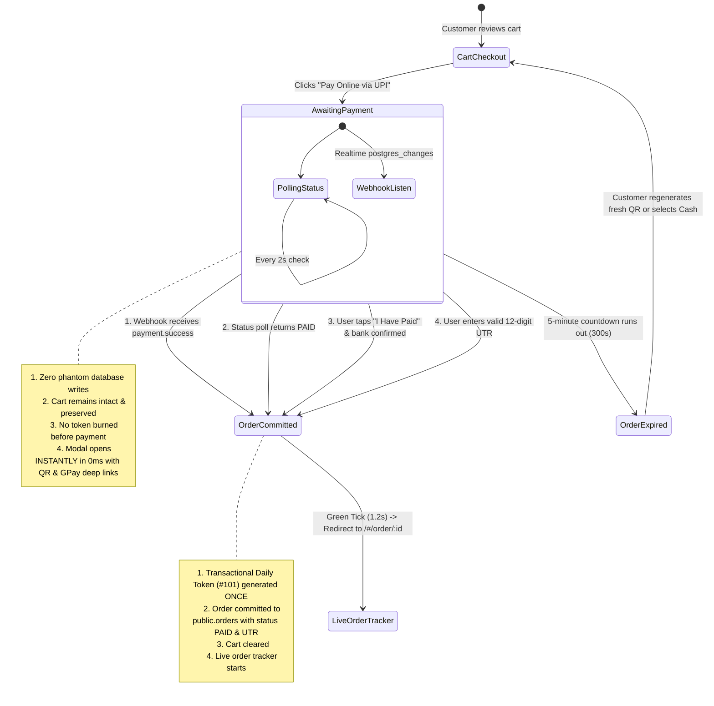

# FoodFax — Payment Gateway Architecture & UPI Operations Manual

> **Official Single Source of Truth for FoodFax Payment Systems (Customer App, Shop Owner Dashboard, Admin Panel)**  
> **Platform Merchant:** Mohit Santosh Singh  
> **Merchant UPI VPA:** `bharatpe2e0p0d8x5a59798@unitype`  
> **Gateway Partner:** BharatPe Business & UPIQRPay Infrastructure  
> **Last Updated & Hardened:** October 2026

---

## 1. Executive Summary & Merchant Model

FoodFax uses a **Centralized Platform Merchant Collection Model** designed specifically for Indian street food stalls, food trucks, and counter restaurants.

```
┌─────────────────┐       UPI Scan / GPay       ┌────────────────────────┐
│    Customer     │ ──────────────────────────> │ Platform Merchant VPA  │
│  (Ordering App) │                             │  (Mohit Santosh Singh) │
└─────────────────┘                             └────────────────────────┘
         │                                                   │
         │ Realtime Polling / Webhook                        │ Daily / Weekly
         ▼                                                   │ Settlement
┌─────────────────┐                                          ▼
│ FoodFax Supabase│                             ┌────────────────────────┐
│  Orders & DB    │                             │   Stall / Shop Owner   │
│  (Token Queue)  │                             │   (Cash / Bank Payout) │
└─────────────────┘                             └────────────────────────┘
```

### Key Principles:
1. **Single Central Platform Merchant:** Sabhi street food shops aur stalls ke online customer payments centrally platform merchant (`Mohit Santosh Singh` — `bharatpe2e0p0d8x5a59798@unitype`) ke BharatPe Business account par aate hain.
2. **Stall Payout Settlement:** Stall owners ko har din / cycle ke ant me unki total verified sales ka payout platform se collect hota hai. (Future roadmap me bade brand restaurants ke liye direct merchant bypass switch `enable_direct_merchant` supported hai).
3. **Zero Phantom Debits (Money Deducted, No Order):** Har online payment attempt se pehle database me sequential token ke saath `PENDING` order lock hota hai. Agar customer ka paisa cut ho jaye, toh order kabhi vanish nahi ho sakta.
4. **Strict Price Integrity:** Cart me ₹1 hai toh customer se exact **₹1.00** hi pay karwaya jayega. Dynamic paise adjustment (`₹1.03`, `₹1.04`) frontend client level par completely disabled hai taaki customer confuse na ho aur banking security decline trigger na ho.

---

## 2. Platform Merchant Credentials & Configuration

| Parameter | Configuration Value | Usage / Scope |
| :--- | :--- | :--- |
| **Merchant Banking Name** | `Mohit Santosh Singh` | UPI Payee Name (`pn`) NPCI compliance |
| **Merchant UPI ID (VPA)** | `bharatpe2e0p0d8x5a59798@unitype` | Central receiver UPI VPA (`pa`) |
| **Provider / Settlement** | BharatPe Business (Unity Small Finance Bank) | Payout settlement & merchant soundbox |
| **Dynamic Gateway Engine** | UPIQRPay API (`https://upiqrpay.in/api/v1`) | Dynamic QR, status polling & webhooks |
| **Default Gateway API Key** | `e8b41962-f509-4f57-9663-33ffd33e47a1` | Serverless backend API requests |
| **Webhook Endpoint** | `https://foodfax.in/api/payment/webhook` | Asynchronous bank payment confirmation |

---

## 3. Order Placement & Payment State Machine

FoodFax implement karta hai ek **Strict Post-Payment Verification Atomic State Machine**:



### State Breakdown:
1. **Zero Premature Commitment (No Phantom Tokens):** Jab customer "Pay Online via UPI" click karta hai, cart items ki snapshot banayi jaati hai aur instant modal khulta hai. **Database me order row insert nahi hoti aur token (#101, #102) burn nahi hota** jab tak payment confirm na ho jaye. Isse bar-bar click karne par tokens waste hona band ho gaya hai.
2. **Instant QR Render (0ms Latency):** UI kisi slow remote gateway ka wait nahi karta. High-res standard UPI QR immediately render hota hai jo customer ke scanner par direct `Mohit Santosh Singh` show karta hai.
3. **Triple Verification Redundancy:**
   - **Method A (Webhook):** UPIQRPay / BharatPe webhook `/api/payment/webhook` par notification bhejta hai.
   - **Method B (Automated 2s Polling):** `/api/payment/status?payment_id=:id` background me poll hota hai.
   - **Method C (Manual UTR Fallback):** Agar bank SMS late ho ya internet slow ho, customer apne GPay/PhonePe se 12-digit UPI UTR (`429618392014`) enter karke instantly order confirm kar sakta hai.
4. **Order Commitment on Verified Payment:** Jaise hi payment verify hoti hai:
   - Single sequential token assign hota hai.
   - Order `public.orders` me `payment_status: 'PAID'` aur `utrNumber` ke saath save hota hai (with serverless fallback `/api/order/create` if client RLS blocks direct anon writes).
   - Cart clear hoti hai aur customer [Live Order Tracker (`/#/order/:orderId`)](file:///Users/mohitsingh/Documents/GitHub/foodfax/src/views/OrderTrackerView.tsx) par redirect hota hai.
5. **Active Order Banner Integrity:** Header me active order tracking banner sirf tab dikhta hai jab order ka `paymentStatus === 'PAID'` ho ya order `CASH_AT_COUNTER` ho. Unpaid payment attempts banner me show nahi hote.

---

## 4. UPI Deep Link Specifications (Google Pay, PhonePe, Paytm)

NPCI UPI Specifications aur Google Pay (Tez) deep linking guidelines ke mutabiq parameters format kiye jate hain.

### URL Construction Rules:
- **No Plus Signs (`+`):** Spaces ko hamesha standard percent-encoding (`%20`) kiya jata hai. `+` use karne se Google Pay *"Could not load banking name"* ya *"Cannot pay with this QR code"* throw karta hai.
- **2-Decimal Amount (`am`):** `(grandTotal).toFixed(2)` — hamesha strict `1.00`, `50.00` (kabhi exponential ya single decimal nahi).
- **Unique Transaction Reference (`tr`):** Order ID ke sath linked (`ord-1792776849858-260`) for bank reconciliation.

### Deep Link Mapping:

| App | URI Scheme Pattern | Example |
| :--- | :--- | :--- |
| **Google Pay (Tez)** | `tez://upi/pay?pa={pa}&pn={pn}&am={am}&cu=INR&tn={tn}&tr={tr}` | `tez://upi/pay?pa=bharatpe2e0p0d8x5a59798@unitype&pn=Mohit%20Santosh%20Singh&am=1.00&cu=INR&tn=FoodFax%20Order&tr=ord-101` |
| **PhonePe** | `phonepe://pay?pa={pa}&pn={pn}&am={am}&cu=INR&tn={tn}&tr={tr}` | `phonepe://pay?pa=bharatpe2e0p0d8x5a59798@unitype&pn=Mohit%20Santosh%20Singh&am=1.00&cu=INR&tn=FoodFax%20Order&tr=ord-101` |
| **Paytm** | `paytmmp://pay?pa={pa}&pn={pn}&am={am}&cu=INR&tn={tn}&tr={tr}` | `paytmmp://pay?pa=bharatpe2e0p0d8x5a59798@unitype&pn=Mohit%20Santosh%20Singh&am=1.00&cu=INR&tn=FoodFax%20Order&tr=ord-101` |
| **Generic UPI / BHIM** | `upi://pay?pa={pa}&pn={pn}&am={am}&cu=INR&tn={tn}&tr={tr}` | `upi://pay?pa=bharatpe2e0p0d8x5a59798@unitype&pn=Mohit%20Santosh%20Singh&am=1.00&cu=INR&tn=FoodFax%20Order&tr=ord-101` |

---

## 5. Security, Anti-Fraud & 12-Digit UTR Verification

Jab customer manual UTR enter karta hai, code teen strict layers me validation karta hai:

```
Customer Input (UTR)
         │
         ▼
[ Layer 1: Regex & Length ] ──> Must be strictly 12 digits: /^[0-9]{12}$/
         │
         ▼
[ Layer 2: NPCI Fraud Block ] ──> Blocks:
                                  - Leading zeros (NPCI RRN never starts with 0)
                                  - Sequential patterns ('123456789012')
                                  - Repetitive digits ('111111111111', '000000000000')
         │
         ▼
[ Layer 3: Anti-Replay DB ] ───> Checks Supabase `orders` & `payments`:
                                  Blocks reusing an already verified UTR
                                  from a previous order (Duplicate Attack Prevention)
         │
         ▼
Order Confirmed & Marked PAID
```

### Implementation Reference:
- Function: `validateUpiUtr()` in [`src/utils/orderValidation.ts`](file:///Users/mohitsingh/Documents/GitHub/foodfax/src/utils/orderValidation.ts)
- Anti-Replay DB Check: `firestoreSync.isUtrAlreadyUsed()` in [`src/services/firestoreSyncService.ts`](file:///Users/mohitsingh/Documents/GitHub/foodfax/src/services/firestoreSyncService.ts)

---

## 6. Serverless API Endpoints Specification

### 1. `POST /api/payment/create-order`
- **File:** [`api/payment/create-order.ts`](file:///Users/mohitsingh/Documents/GitHub/foodfax/api/payment/create-order.ts)
- **Role:** Registers order with UPIQRPay dynamic engine in background.
- **Request Body:**
  ```json
  {
    "order_id": "ord-1792776849858-260",
    "customer_phone": "9876543210",
    "customer_name": "Mohit Singh",
    "amount": 1,
    "shop_id": "sharma-vada-pav"
  }
  ```
- **Response (200 OK):**
  ```json
  {
    "success": true,
    "data": {
      "payment_id": "pay_982348234",
      "amount": 1,
      "order_id": "ord-1792776849858-260",
      "qr_code": "https://upiqrpay.in/qr/pay_982348234.png",
      "upi_link": "upi://pay?pa=bharatpe2e0p0d8x5a59798@unitype&...",
      "status": "pending"
    }
  }
  ```

### 2. `GET /api/payment/status`
- **File:** [`api/payment/status.ts`](file:///Users/mohitsingh/Documents/GitHub/foodfax/api/payment/status.ts)
- **Role:** Polled by frontend every 2 seconds.
- **Optimization:** Pehle local PostgreSQL `orders` table me check karta hai (`payment_status === 'PAID'`). Agar match ho jaye toh bina external API lag ke instant `PAID` respond karta hai. Agar database me pending hai toh UPIQRPay gateway se status fetch karta hai.

### 3. `POST /api/payment/webhook`
- **File:** [`api/payment/webhook.ts`](file:///Users/mohitsingh/Documents/GitHub/foodfax/api/payment/webhook.ts)
- **Role:** Receives asynchronous bank callbacks from UPIQRPay / BharatPe.
- **HMAC Verification:** Validates `X-Upiqrpay-Signature` against platform webhook secret.
- **Atomic Database Write:**
  - Updates `orders.payment_status = 'PAID'`
  - Updates `orders.utr_number = utr_number`
  - Upserts into `payments` table with standard schema fields (`payment_mode: 'PAY_ONLINE'`, `amount`, `transaction_id`, `paid_at`).

---

## 7. Database Grounding (Schema & Foreign Keys)

FoodFax payments PostgreSQL standard schema follow karte hain without any phantom columns:

### `public.orders` Table:
```sql
payment_method TEXT NOT NULL CHECK (payment_method IN ('CASH_AT_COUNTER', 'PAY_ONLINE')),
payment_status TEXT NOT NULL DEFAULT 'PENDING' CHECK (payment_status IN ('PENDING', 'PAID', 'COLLECT_ON_DELIVERY', 'REFUNDED', 'FAILED')),
utr_number TEXT,
total NUMERIC(10,2) NOT NULL
```

### `public.payments` Table:
```sql
CREATE TABLE IF NOT EXISTS public.payments (
  id TEXT PRIMARY KEY,
  order_id TEXT NOT NULL REFERENCES public.orders(id) ON DELETE CASCADE,
  payment_mode TEXT NOT NULL,
  payment_status TEXT NOT NULL DEFAULT 'PENDING',
  amount NUMERIC(10,2) NOT NULL,
  transaction_id TEXT, -- Stores NPCI 12-digit UTR
  provider TEXT DEFAULT 'upiqrpay',
  paid_at TIMESTAMPTZ,
  created_at TIMESTAMPTZ DEFAULT NOW(),
  updated_at TIMESTAMPTZ DEFAULT NOW()
);
```

---

## 8. Common Payment Issues & Fixes (Troubleshooting)

### Issue A: Google Pay shows *"Could not load banking name"* or *"Cannot pay with this QR code: No payment account registered on Google Pay"* (or Payee appears as *"Paying FoodAds"*)
- **Exact Root Cause Breakdown:**
  1. **Gateway Overwrite Glitch:** Jab checkout modal open hota tha, pehle instant canonical QR generate hota tha. Lekin background me UPIQRPay gateway API (`/order/create`) call hoti thi. UPIQRPay apne default unlinked merchant account ka naam **"FoodAds"** return karta tha jisme spaces ko `+` encode kiya gaya tha (`Order+ord-1792776849858-260`).
  2. **Unregistered VPA in Google Pay:** UPIQRPay ka jo default QR/UPI link tha (`foodads@upi`), wo Google Pay par registered merchant bank account nahi tha. Is wajah se jab customer scan karta tha, Google Pay error deta tha: *"Cannot pay with this QR code: No payment account registered on Google Pay"*.
  3. **Plus Sign Syntax Malformation:** URL me `+` signs (`Order+ord-...`) hone se Google Pay banking name fetch nahi kar pata tha aur *"Could not load banking name"* screen aati thi.
- **Architectural Solution & Permanent Fix:**
  - **`sanitizeCheckoutUpiData()` Guard:** Client checkout flow me `sanitizeCheckoutUpiData` implement kiya gaya hai. Gateway API se sirf `payment_id` liya jata hai background polling ke liye, jabki customer ko dikhaya jaane wala QR code aur UPI deep links **permanently locked** rehte hain Platform Merchant:
    - **Merchant Name:** `Mohit Santosh Singh` (Payee Name `pn`)
    - **Merchant UPI ID:** `bharatpe2e0p0d8x5a59798@unitype` (Payee VPA `pa`)
    - **Encoding:** Strict RFC 3986 percent-encoding (`%20`), kabhi bhi `+` use nahi hota.
  - **Zero Third-Party Alias Overwrite:** Third-party gateway ka koi bhi unverified `qr_code` ya `upi_link` screen par render nahi hoga. Customer seedha Mohit Santosh Singh ke BharatPe verified account par pay karta hai.
  - **Self-Transfer NPCI Security Policy:** Agar shop owner / developer apne hi usi Google Pay account se payment test karega jisme unka recipient bank link hai, toh bank declines de sakta hai (*"Self-Transfer not allowed"*). Testing ke liye hamesha alag family/friend UPI account use karein.

### Issue B: Google Pay shows *"Payment to this receiver was declined. To protect your money..."*
- **Cause:** NPCI fraud warning trigger hoti hai jab:
  1. Ek customer account se naye BharatPe merchant par pehli baar payment ho rahi ho.
  2. Amount me fractional paise (`₹1.03`, `₹1.04`) jud gaye hon jo micro-transaction risk trigger karte hain.
- **Fix:**
  - `am` ko exact integer/2-decimal cart value par lock rakha gaya hai (`₹1.00`).
  - Customer ko screen par prompt karein to tap "Continue / Pay anyway" on Google Pay warning, ya modal me seedha QR scan karein / 12-digit UTR enter karein.

### Issue C: Amount changes from ₹1 to ₹1.03 / ₹1.04
- **Cause:** Legacy UPIQRPay dynamic paise matching.
- **Fix:** Client me `payableAmount = grandTotal` lock hai. Upstream API response kabhi bhi customer cart amount ko overwrite nahi karegi.

### Issue D: Customer paid money, but order did not create
- **Cause:** Pre-creation missing hone se webhook foreign key violation par fail ho raha tha.
- **Fix:** Order modal open hote hi `orders` table me `PENDING` status aur daily token ke sath save ho jata hai. Verification aate hi status `PAID` mark hota hai bina kisi record drop ke.

---

## 9. Verification & Automated Test Suite

Payment security and formatting automated test suite se protected hai:

```bash
npm test
```

### Active Payment Test Suites:
1. `src/services/paymentService.test.ts`:
   - Enforces platform merchant identity (`bharatpe2e0p0d8x5a59798@unitype`, `Mohit Santosh Singh`).
   - Verifies RFC 3986 percent-encoding (`%20`, no `+`).
   - Enforces `sanitizeCheckoutUpiData` to prevent "FoodAds" and third-party QR overwrite.
   - Normalizes all gateway status strings (`PAID`, `WAITING`, `REJECTED`, `EXPIRED`).
   - Validates 12-digit NPCI bank UTRs.
2. `src/utils/security.test.ts`:
   - `assertValidOrderSubmission`: Rejects negative prices, zero quantities, and mismatched item subtotals.
   - `validateUpiUtr`: Validates 12 numeric digits, rejects patterns (`123456`, `111111`), rejects leading zeros.
   - `Central Merchant UPI & Google Pay URI Standards`: Validates `PLATFORM_UPI_ID`, `PLATFORM_MERCHANT_NAME`, and percent-encoded URI string construction.

